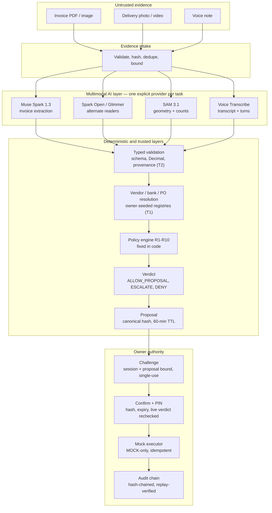

# Airlock — Secure Invoice Intelligence & Payment Control

*Multimodal AI for financial evidence. Deterministic verification for trust. Human authority for payment.*

[](https://github.com/Gouravjaat07/Airlock-Invoice-Security-Meta-AI-Hackathon-2026/actions/workflows/ci.yml)
[](pyproject.toml)
[](app/main.py)
[](web/package.json)
[](web/package.json)
[](LICENSE)

**Airlock is a Meta-AI-powered invoice intelligence, evidence-verification,
and payment-control system.** It reads supplier invoices, delivery evidence,
and voice notes with multimodal Meta models, checks every extracted fact
against owner-seeded vendor, bank, and purchase-order records using a
deterministic R1–R10 policy engine, and lets only the authenticated owner
authorize the exact payment proposal — execution stays mock-only.

> **An invoice can request a payment. It can never authorize one.**

**AI interprets evidence. Deterministic policies verify evidence. The
authorized owner controls payment authority.** Airlock is not an invoice OCR
tool, a PDF summarizer, or a chatbot: it is a financial control system in
which AI output is treated as untrusted input from the first byte to the
final verdict.

**Live Demo: [AirLock Live Demo](https://youtu.be/Cf2HFNPz_vI)

**Evaluating Airlock? Start here:** [Evaluator Quick Path](#evaluator-quick-path)
→ [docs/EVALUATOR_GUIDE.md](docs/EVALUATOR_GUIDE.md) (five minutes, no keys).

## Contents

- [What Airlock Does](#what-airlock-does)
- [The Problem](#the-problem)
- [Why Meta AI Is Central to Airlock](#why-meta-ai-is-central-to-airlock)
- [Architecture](#architecture)
- [End-to-End Workflow](#end-to-end-workflow)
- [Deterministic Policy Engine (R1–R10)](#deterministic-policy-engine-r1r10)
- [Security and Trust Architecture](#security-and-trust-architecture)
- [Algorithms and Engineering Decisions](#algorithms-and-engineering-decisions)
- [Product Experience and Frontend](#product-experience-and-frontend)
- [Evaluation and Benchmark Results](#evaluation-and-benchmark-results)
- [Live Meta Model Evaluation](#live-meta-model-evaluation)
- [Engineering Validation and CI](#engineering-validation-and-ci)
- [Repository Structure](#repository-structure)
- [Quickstart and Installation](#quickstart-and-installation)
- [Meta API Configuration and Live Smoke Testing](#meta-api-configuration-and-live-smoke-testing)
- [Evaluator Quick Path](#evaluator-quick-path)
- [Differentiation and Technical Contribution](#differentiation-and-technical-contribution)
- [Product Impact and Future Direction](#product-impact-and-future-direction)
- [Operating Scope and Known Boundaries](#operating-scope-and-known-boundaries)
- [License, Documentation and Acknowledgements](#license-documentation-and-acknowledgements)

## What Airlock Does

Airlock separates invoice payment into three hard boundaries:

| Boundary | Question | Answered by |
|---|---|---|
| **Intelligence** | What does the evidence say? | Multimodal Meta AI (Spark, Voice Transcribe, SAM) — output labeled **untrusted (T2)** |
| **Verification** | Is it consistent with trusted records? | Deterministic policy engine **R1–R10** over validated inputs |
| **Authority** | May this exact payment proceed? | The **authenticated owner**, via challenge + PIN on the proposal hash |

**AI may interpret. Policy may evaluate. Only the authorized owner may
approve.** Every model result enters the pipeline as tainted data, passes
schema validation and provenance tracking, and can influence at most a
policy verdict — never an authorization. Execution is handled by a mock-only
payment service: no real payment rail exists in the codebase.

## The Problem

Small finance teams still clear supplier invoices by eyeballing PDFs. That
process silently absorbs real payment risks:

- **Supplier bank-account substitution** — a changed account number on an
  otherwise familiar invoice.
- **Duplicate submissions** — the same invoice paid twice under a
  different filename or number spelling.
- **Vendor impersonation and lookalikes** — near-identical names,
  homoglyphs, and shell variants.
- **Mathematical inconsistencies** — line totals, tax, and grand total
  that do not reconcile exactly.
- **Purchase-order mismatches** — unknown, closed, over-claimed, or
  wrong-currency POs.
- **Delivery quantity discrepancies** — billed quantities that do not
  match what arrived.
- **Conflicting voice or visual evidence** — spoken instructions or
  delivery photos that contradict the paperwork.
- **Prompt injection in untrusted documents** — instructions hidden in
  invoice text, vendor names, or speech that target the reader model.
- **Model failures** — timeouts, malformed output, and unavailable
  providers during verification.
- **Incomplete or contradictory evidence** — missing fields that must
  never be silently treated as clean.

Conventional document extraction answers "what text is on this page?" but
cannot answer "is this payment valid, and who authorized it?" Airlock adds
the two missing layers: deterministic verification against trusted records,
and an explicit, replay-protected owner authorization boundary. No market,
savings, or fraud-rate statistics are cited here — Airlock's published
evidence is its reproducible offline benchmark
([§ Evaluation](#evaluation-and-benchmark-results)), not industry claims.

## Why Meta AI Is Central to Airlock

Meta models are not a plug-in here — each one owns a distinct evidence
channel in the pipeline, and the system is designed around what each model
can and cannot be trusted to decide. Model identifiers below were
cross-checked against Meta's official model pages on 2026-11-07
([Spark](https://dev.meta.ai/models/muse-spark),
[Voice Transcribe](https://dev.meta.ai/models/muse-voice-transcribe),
[SAM 3.1](https://dev.meta.ai/models/sam-3-1); Spark Open and Glimmer appear
in Meta's official model navigation).

| Meta model | Input | Actual output | Role in Airlock | Trust boundary | Current availability |
|---|---|---|---|---|---|
| **Muse Spark 1.3** (`muse-spark-1.3`) | Invoice PDF/image bytes, inline base64 | Schema-constrained JSON (`invoice_extraction`) | Typed invoice extraction with provenance | T2 untrusted; must pass validation + R1–R10 | Adapter implemented, contract-tested vs mocks; live **NOT_TESTED** |
| **Muse Voice Transcribe** (`muse-voice-transcribe-1.0`) | WAV (RIFF mono 16-bit PCM, ≤300 s) | Transcript + speaker turns | Voice evidence for deterministic comparison | Evidence only; never identity or authorization | Adapter implemented, contract-tested vs mocks; live **NOT_TESTED** |
| **SAM 3.1** (`sam-3.1`) | Delivery image/MP4 + one catalogue-noun concept | Mask lane → count + boxes + mask areas | Geometry/count observations for delivery evidence | Geometry only; never a quantity verdict | Adapter implemented, contract-tested vs mocks; live **NOT_TESTED** |
| **Muse Spark Open** via Baseten (`meta-models/muse-spark-open-1026`) | Invoice images only (PDF refused: no file part) | Same extraction schema | Alternate reader, same validation path | Same as Spark | Adapter implemented; live **NOT_TESTED** |
| **Muse Glimmer** (`muse-glimmer`, loopback) | Invoice images only | Same extraction schema | Local-runtime reader experiment | Same as Spark | Adapter + preflight probe implemented; no local runtime demonstrated; **NOT_TESTED** |

### Meta Muse Spark 1.3 — invoice intelligence

`app/providers/spark.py` (`meta-spark` 3.0.0) sends the invoice inline over
the Meta Model API (`POST /v1/responses`, `store:false`, no server-side
retention) with extraction instructions v5 and **native constrained
generation** (`text.format` JSON schema, `strict:false`) — and then treats
that output as untrusted anyway. The shared finalize path
(`app/providers/extraction.py`) enforces a 200 KB cap, a field allowlist,
alias rejection, ambiguous-currency drops, and evidence-page grounding
before `InvoiceExtraction` (`extra=forbid`, Decimal-only money, ISO dates,
strict line items) validates it. Provenance — adapter, model, prompt
version, request id, usage, warnings — is recorded on every fact and in the
audit log. Malformed or truncated output becomes an R8 schema failure (DENY
verdict), never a crash.

### Meta Muse Voice Transcribe — voice evidence

`app/providers/voice.py` (`meta-voice` 3.0.0) transcribes stored recordings
via `POST /v1/asr/transcribe` (multipart JSON + audio, push-to-talk mode).
Only validated WAV reaches the model; anything else is rejected, never
converted. Comparison is fully deterministic
(`voice_conflict_details`): instruction markers, `PO-*`/`INV-*` token
mismatches, and spoken-amount-vs-total differences escalate through R7 —
while an absent mention is never a conflict. **Voice content is evidence,
not identity verification and never payment authorization.** Malicious
speech stays data: instruction-like language escalates, it cannot approve.
Realtime WebSocket mode is deliberately not implemented — Airlock has no
realtime requirement.

### Meta SAM 3.1 — delivery evidence as geometry

`app/providers/sam.py` (`meta-sam` 3.0.0) sends one concept request per
delivery artifact over Responses SSE. The concept prompt is built **only
from the trusted vendor-catalogue label** (`sam_concept_prompt`) — never
from invoice text, so there is no text path from an untrusted document into
the vision query. The streamed special-token lane is parsed with a
documented grammar (`sam_parse.py`) and every mask raster is decoded with
an explicit codec port (`sam_mask.py`), yielding a track-aware object count
plus bounded boxes (≤500 stored) with decoded mask areas. R7 compares the
count against invoiced quantities within catalogue tolerance.
**Segmentation alone establishes none of the following: item identity,
delivery authenticity, commercial acceptance, or payment authority.**
Fractional invoiced quantities cannot be count-compared and honestly
conflict; unevaluated bytes are labeled `not_evaluated`, never green.

### Muse Spark Open through Baseten — alternate reader

`app/providers/baseten.py` (`baseten-spark-open` 3.0.0) is a separate
provider adapter — not a Meta client with a different token — speaking
`chat/completions` against the configured Baseten base URL through the
shared chat-protocol core (`app/providers/chat.py`). Image input only: the
chat protocol has no PDF file part, so PDFs are refused explicitly rather
than misrouted. Output flows through the identical finalize + validation +
policy path as Spark. It is an explicitly selected alternate reader, not an
automatic fallback — Airlock implements no silent fallback anywhere.

### Muse Glimmer — local-runtime reader

`app/providers/glimmer.py` (`glimmer-local` 3.0.0) targets an
OpenAI-compatible endpoint on loopback (`GLIMMER_BASE_URL`, plain HTTP
accepted for loopback hosts only) through the same chat core. The local
endpoint is never assumed: every call is a normal guarded request, and a
`preflight` probe (`GET /models`) reports reachability without ever raising.
The adapter performs no model downloads, no weight management, and makes no
GPU assumptions. Distinguish clearly: the **adapter is implemented and
tested**; local inference itself has **not been demonstrated** in this
repository (no local runtime was available; preflight reports reachability
only, never inference quality).

### What makes the integration meaningful

- **Independent evidence modalities.** Document, voice, and visual channels
  are gathered separately and can corroborate or contradict each other —
  a single AI result can never make a financial decision.
- **Constrained generation plus authoritative local validation.**
  Spark's schema-constrained decoding reduces malformed output; server-side
  validation remains the authority that policy sees.
- **Explicit provider selection, no silent fallback.** One provider per
  task (`AIRLOCK_READER_PROVIDER`, `AIRLOCK_VOICE_PROVIDER`,
  `AIRLOCK_VISION_PROVIDER`); failures raise typed errors, never reroute
  to another model or to fixtures.
- **Typed execution states.** Every lane reports `missing`, `evaluated`,
  `not_evaluated`, `failed`, or `empty` end to end — the pipeline cannot
  express false confidence about evidence it never compared.
- **Prompt isolation.** Vision concepts come from trusted catalogue data;
  extraction prompts are facts-only; instruction-like content anywhere in
  evidence escalates instead of executing.

Deep dive: [docs/META_AI_INTEGRATION.md](docs/META_AI_INTEGRATION.md),
[contracts](docs/integrations/META_API_CONTRACTS.md),
[Spark setup](docs/integrations/MUSE_SPARK_SETUP.md),
[Voice setup](docs/integrations/MUSE_VOICE_SETUP.md),
[SAM setup](docs/integrations/SAM_SETUP.md).

## Architecture



There is deliberately **no path from any AI layer to payment**: verdicts
come from `evaluate_policy`, proposals from `propose.build_proposal`, and
authorization from the owner. Data-flow detail:
[docs/ARCHITECTURE.md](docs/ARCHITECTURE.md),
[docs/DATA_FLOW.md](docs/DATA_FLOW.md),
[trust boundaries](docs/architecture/TRUST_BOUNDARIES.md).

## End-to-End Workflow

Implementation: `app/pipeline/process.py:run_case` (orchestrator),
`app/api/cases.py` + `app/api/proposals.py` (HTTP surface).

| # | Stage | In | What happens | Out |
|---|---|---|---|---|
| 1 | Invoice intake | Uploaded files | Extension allowlist, magic-byte sniff, size/page/pixel caps, SHA-256, same-byte dedupe, idempotency-key reuse | Artifacts in blob store + rows |
| 2 | Structured extraction | Invoice bytes | Registry-selected reader (fixture/Spark/Spark Open/Glimmer); Spark uses constrained JSON generation | T2 extraction + provenance |
| 3 | Schema & provenance validation | Raw extraction | 200 KB cap, field allowlist, Decimal money, ISO dates, strict lines, evidence grounding | `InvoiceExtraction` or R8 failure |
| 4 | Vendor & bank resolution | Validated fields | NFKC-normalized exact vendor resolve; HMAC bank fingerprint vs active record | Resolved vendor or R1/R2 signal |
| 5 | PO reconciliation | PO reference + totals | PO lookup: exists, open, currency match, balance covers total | PO verdict input (R5) |
| 6 | Delivery analysis | Delivery image/MP4 | SAM lane: catalogue-noun concept → count + boxes + areas | Lane outcome + comparison |
| 7 | Voice transcription | WAV audio | Transcriber lane → transcript + turns; deterministic token/amount/marker comparison | Lane outcome + comparison |
| 8 | Corroboration | Lane outcomes | Conflict detection; unevaluated/failed/empty lanes labeled explicitly, never faked | `Corroboration` |
| 9 | R1–R10 evaluation | Facts + corroboration | All ten rules evaluate; fixed precedence: R9/DENY rules, then ESCALATE rules | Rule results + verdict |
| 10 | Verdict | Rule results | `ALLOW_PROPOSAL` \| `ESCALATE` \| `DENY` (+ `ERROR` case state on failure) | Stored verdict + explanation |
| 11 | Proposal | ALLOW verdict | Canonical 9-field hash, 60-minute TTL | Pending proposal |
| 12 | Owner challenge | Pending proposal | Session+proposal-bound, single-use, 5-minute challenge; rate-limited | Challenge id |
| 13 | Confirmation | Challenge + PIN | Re-verify session, challenge, PIN, proposal hash, expiry, **still-current ALLOW verdict** | Confirmed proposal |
| 14 | Mock execution + audit | Confirmed proposal | Idempotent-on-hash MOCK payment in the same transaction as its audit event | `MOCK_COMPLETED` + chain events |

Failure handling is Fail-closed financial authorization path: reader errors surface as
`ERROR:E_READER_*` (no verdict, no proposal); required-verifier errors deny
via R9; optional voice failures are recorded but nonfatal; corrupted or
swapped bytes are rejected before reaching any model; the audit chain is
verifiable by replay at any time (`POST /audit/verify`, or
`scripts/verify_audit_chain.py`).

## Deterministic Policy Engine (R1–R10)

Authoritative code: `app/pipeline/policy.py` (`evaluate_policy`,
`aggregate`); rule record: [docs/phase2/POLICY.md](docs/phase2/POLICY.md);
summary: [docs/POLICY_ENGINE.md](docs/POLICY_ENGINE.md). Rule meanings are
fixed in code — `policy/rules.toml` supplies thresholds only, and rule
on/off switches intentionally do not exist. All ten rules always evaluate;
every result carries rule version, reason code, message, evidence, and
timestamp.

| ID | Rule | What is checked | Evidence used | Fail → |
|---|---|---|---|---|
| R1 | Vendor resolves | Vendor name resolves exactly to an active record | NFKC-normalized name vs registry | DENY |
| R2 | Bank matches | Bank fingerprint matches the active record | HMAC-SHA-256 fingerprint, constant-time compare | DENY |
| R3 | Arithmetic exact | Lines → subtotal, +tax → total reconcile exactly | Decimal money, strict line items | DENY |
| R4 | Not a duplicate | Composite key unseen (`vendor_id \| number \| total \| issue_date`) | Canonical dup key, homoglyph-folded | DENY |
| R5 | Cap + PO authorized | Within per-invoice cap; PO found, open, currency-matching, balance covers | Caps, PO status/currency/balance | ESCALATE |
| R6 | Due date plausible | Due ≥ issue date and within 120 days | ISO dates | ESCALATE |
| R7 | Evidence consistent | No SAM-count or voice conflict; unevaluated lanes named | Lane comparisons | ESCALATE |
| R8 | Required fields present | Schema-valid extraction incl. bank reference | Validated extraction | DENY |
| R9 | Verifiers healthy | Required verifiers ran without error | Lane/verifier outcomes | DENY |
| R10 | Vendor unambiguous | No ≤2-edit lookalike vendor exists | Levenshtein over registry names | ESCALATE |

Precedence is fixed: required-verifier (R9) failure → DENY; then
R1/R2/R3/R4/R8 → DENY; then R5/R6/R7/R10 → ESCALATE; else ALLOW_PROPOSAL.
Semantics worth knowing: a missing bank reference passes R2
(`bank-not-provided`) and denies at R8; R10 fires even when R1 resolved
exactly (an exact match plus a lookalike must not auto-approve); R7 passes
with explicit `evidence-not-evaluated` when uploaded bytes could not be
compared; R9 denies on missing bank key and required SAM errors while
optional voice failures stay nonfatal.

Verdict meanings:

- **ALLOW_PROPOSAL** — all deterministic checks passed; a payment proposal
  *may be created*. It is not payment authorization.
- **ESCALATE** — suspicious or uncertain; a human must review. Nothing
  proceeds automatically.
- **DENY** — a hard check failed; no proposal is created.
- **ERROR** — processing itself failed (e.g. `ERROR:E_READER_TIMEOUT`):
  no verdict, no proposal, explicit error state.

Policy outcomes are deterministic over validated inputs — same extraction +
same registries + same policy version → same verdict — while input quality
remains dependent on the available evidence and the extraction process.

## Security and Trust Architecture

Threat model: [docs/security/THREAT_MODEL.md](docs/security/THREAT_MODEL.md)
(incl. OWASP GenAI mapping); red-team matrix:
[docs/security/RED_TEAM_TEST_MATRIX.md](docs/security/RED_TEAM_TEST_MATRIX.md);
policy: [SECURITY.md](SECURITY.md). Every control below was verified in
code; residual risks are stated, not hidden.

**Verified controls.** Untrusted-document handling (allowlist, magic bytes,
caps); prompt-injection boundary (facts-only prompts, T2 taint, prose never
reaches policy); server-side schema validation (`extra=forbid`); evidence
provenance on every fact; explicit provider selection with no silent
fallback; typed lane states; deterministic R1–R10; Decimal-safe
reconciliation; NFKC normalization; Levenshtein lookalike detection;
HMAC-SHA-256 bank fingerprints with constant-time comparison; composite
duplicate identity with proposal-time race guard; Argon2id PIN hashing with
no default PIN; 256-bit opaque session tokens (SHA-256 stored) in
HttpOnly/Secure/SameSite=Lax cookies; CSRF on all cookie mutations;
proposal-bound single-use 5-minute challenges; canonical 9-field proposal
hash verified at confirm; 60-minute proposal expiry rechecked; idempotent
mock execution; hash-chained audit log verified by replay; global login
lockout (5 attempts / 15 min) plus per-session and challenge rate limits.

**Explicit trust model.**

| Class | Examples | May it decide? |
|---|---|---|
| Untrusted AI output (T2/T3) | Extractions, transcripts, masks, raw bytes | Never — validated input only |
| Trusted records (T0/T1) | Owner PIN/session, vendor/bank/PO registries, policy rules | Reference data for verifiers |
| Deterministic verifier output | Rule results, verdicts, hashes, fingerprints | Yes — within fixed precedence |
| Owner authorization | Challenge + PIN on the exact proposal hash | Yes — the only payment authority |
| Audit evidence | Hash-chained events | Tamper-evident record, verified by replay |

**Fail-closed lane semantics** (`app/pipeline/evidence.py`): `evaluated`
(provider ran, comparison ran); `not_evaluated` (uploaded, comparison could
not run — R7 must not claim consistency); `failed` (provider/transport/
integrity error); `empty` (provider succeeded with zero usable content);
`missing` (nothing uploaded). When a verifier times out, returns malformed
output, or cannot establish a fact, the lane says so explicitly and policy
treats the gap as a gap — required gaps deny (R9), optional gaps escalate
or stay visibly unevaluated (R7).

### Current Security Scope and Deployment Requirements

A prior audit found the case/vendor read endpoints and case
intake/processing unauthenticated. **Fixed 2026-11-07:** every
operational route now requires an owner session, classified in a single
registry ([`app/api/access.py`](app/api/access.py)) and enforced by
[`tests/security/test_access_matrix.py`](tests/security/test_access_matrix.py)
(registry↔route sync, dependency inspection, anonymous→401 and
CSRF-less→403 probes over all 31 endpoints). Only `/health`,
`/auth/login`, and the framework docs routes are public; cookie
mutations require CSRF (documented exemptions: `/logout`
self-revocation and the `/csrf-refresh` bootstrap); spend-capable
routes (`process`, dev-only evaluation) are owner-only. Full matrix:
[docs/security/API_AUTHORIZATION_MATRIX.md](docs/security/API_AUTHORIZATION_MATRIX.md).

**Evaluator access without bypass:** evaluators run
`scripts/setup_airlock.py` once (PIN hash + secrets into gitignored
`.env`), load `.env` into the demo shell, and sign in normally — session
cookie + CSRF token authorize every documented route, and OpenAPI stays
publicly readable for inspection. There is no default PIN, bypass
header, or backdoor. See [Evaluator Quick Path](#evaluator-quick-path).

Remaining deployment notes: Airlock is not claimed to be fully secure,
fraud-proof, prompt-injection-proof, or independently certified; the
audit chain is tamper-evident, not tamper-proof against a privileged DB
administrator; the global login lockout trades brute-force resistance
against lockout-DoS (both documented trade-offs); single-owner SQLite
with prototype ceilings stays the scaling boundary.

## Algorithms and Engineering Decisions

| Mechanism | Why it exists | Where |
|---|---|---|
| Python `Decimal` | Financial arithmetic without binary floating-point rounding | Schemas, R3/R5 |
| Unicode NFKC + casefold | Consistent text normalization; folds homoglyph/case/spacing games | `domain/vendors.py`, `core/security.py` |
| Levenshtein (cutoff ≤2) | Vendor lookalike detection (R10); WER/CER media metrics | `pipeline/registry.py`, `evaluation/media_metrics.py` |
| HMAC-SHA-256 | Bank-reference fingerprints keyed by a dedicated secret | `core/security.py` |
| Constant-time comparison | Reduced timing leakage in fingerprint/secret checks | `core/security.py` |
| Composite duplicate identity | `vendor_id \| number \| total \| issue_date` distinguishes resubmissions | R4, `propose.py` race guard |
| Argon2id | PIN hashing; no default PIN, fails closed without a hash | `auth/pin.py` |
| Canonical JSON + SHA-256 | Proposal hashes and audit-chain event hashes | `propose.py`, `audit_service.py` |
| Single-use challenge | Session+proposal-bound, 5-minute approval token; prevents replay | `auth/challenges.py` |
| Idempotency | Intake keys + proposal-hash execution guard prevent duplicate work/payments | `case_service.py`, `mock_payment_service.py` |
| SQLite transactions + WAL | Consistent state changes; audit written in the same transaction | `storage/database.py` |
| Bounded provider calls | Per-task timeouts, ≤2 retries, ≤2 inflight, 5-fail/60 s breaker | `providers/resilience.py` |

Every entry above names real code — no generic algorithm padding.

## Product Experience and Frontend

Owner console: React 19 + React Router v7 + TanStack Query v5 + Vite 7 +
TypeScript 5.7 (`web/`). `/login` is public; every other route sits behind
the session guard with an honest 404 for unknown paths. The backend is
authoritative for all state; the console renders trust boundaries instead
of hiding them — lane badges distinguish evaluated, unevaluated, failed,
and empty evidence, and the approval flow keeps the challenge bearer token
in component state only (never rendered, never stored, cleared on
completion). Architecture:
[docs/phase4/FRONTEND_ARCHITECTURE.md](docs/phase4/FRONTEND_ARCHITECTURE.md).

| Route | Page | What the owner can do |
|---|---|---|
| `/` | Dashboard | Data-driven overview from `/dashboard/summary` |
| `/cases` | Cases | Case list with pagination |
| `/cases/new` | Intake | Upload invoice (required) + delivery/voice evidence (optional); one idempotency key across retries |
| `/cases/:caseId` | Case detail | Evidence, facts with provenance, verdict, explanation; document preview |
| `/proposals` | Proposals | Pending proposals awaiting decision |
| `/proposals/:proposalId` | Proposal review | Review exact proposal → challenge → PIN confirm |
| `/audit` | Audit | Global audit trail (newest first) + hash-chain verification |
| `/providers` | Providers | Provider status exactly as the backend reports it — no live probing |
| `/settings` | Settings | Read-only session info, backend health, console notes |

Loading, error, and incomplete-evidence states are implemented per view;
no screenshots are shipped with the repository, so none are shown here.

## Evaluation and Benchmark Results

Methodology first: the published benchmark replays **synthetic,
deterministic fixtures** through the offline pipeline and compares verdicts
against declared expectations. It measures the deterministic
policy-regression layer — **it does not measure general-purpose Meta model
accuracy**, live extraction quality, or production outcomes. Full report:
[docs/evaluation/MODEL_BENCHMARK_REPORT.md](docs/evaluation/MODEL_BENCHMARK_REPORT.md);
snapshot:
[benchmark_snapshot_2026-11-04.json](docs/evaluation/benchmark_snapshot_2026-11-04.json);
preregistration: [prereg/PREREGISTRATION.md](prereg/PREREGISTRATION.md);
manifest: [eval/manifest.schema.json](eval/manifest.schema.json).

| Check | Result | Command |
|---|---|---|
| Synthetic verdict agreement | **19/19 matched** (ALLOW n=5, ESCALATE n=6, DENY n=8 incl. 1 declared `ERROR`) | `scripts/phase3_eval.py` |
| Adversarial false-ALLOW | **0/10** scenarios (attack vocabulary A01–A16) | `scripts/phase3_eval.py` |
| Schema validation | **15/15** (4 failure variants covered by the verdict part) | `scripts/phase5_eval.py` |
| Policy coverage | **R1–R10 every rule fires ≥ once** (R1×2 R2×3 R3×2 R4×3 R5×3 R6×2 R7×2 R8×2 R9×1 R10×2) | `scripts/phase3_eval.py` |
| Fixture integrity | 23 binaries + 19 scenarios, drift check green | `scripts/make_fixtures.py --check` |
| Backend suite | **1049 collected — 1046 passed, 1 skipped, 2 environment-blocked** (2026-11-07; socket-denied sandbox, both pass on CI) | `pytest -q -p no:cacheprovider --basetemp=pytest-of-*` |
| Frontend | **65/65 vitest** + typecheck + lint + build green | `npm test`, `typecheck`, `lint`, `build` |
| Offline latency | p50 ≈ 36 ms/case (5-case benchmark; fixture reader, temp DB) | `scripts/phase5_benchmark.py --cases 5` |
| Live Spark extraction quality | **NOT_TESTED ON A LABELLED LIVE CORPUS** (metric `score_extraction` ready) | opt-in `--live --allow-billable` |
| Live voice quality (WER/CER) | **NOT_TESTED** (metrics defined + unit-tested) | opt-in smoke |
| Live SAM count accuracy | **NOT_TESTED** (count-error/MAE defined + unit-tested; geometry-only by design) | opt-in smoke |

Notes: the DENY recall of 0.875 (7 exact + 1 declared-error `reader-timeout`)
is honest accounting, not a bug — the fail-closed `ERROR:E_READER_TIMEOUT`
matches its spec while not being an exact DENY. Offline fixture-reader
latency says nothing about live provider latency (bounded by per-task
timeouts: connect 10 s, extraction 180 s, voice/SAM 300 s). No customer
data exists — there are no real invoices processed, fraud-prevention rates,
savings, or adoption figures to report, and none are implied.

## Live Meta Model Evaluation

Beyond the deterministic offline benchmark, Airlock ships a labelled
live-model evaluation framework (`app/evaluation/live/`,
`scripts/live_eval.py`) over a frozen synthetic corpus
(`eval/datasets/synth-v1`, seed `20261107`): **30 labelled invoice
PDFs**, **30 labelled visual scenes**, **30 voice scripts with
transcripts** (audio unrealized — no offline TTS in the sandbox),
and **15 cross-modal pipeline scenarios**, with stratified
dev/val/heldout splits, SHA-pinned manifest, and independent ground
truth the models never see. Dataset:
[docs/evaluation/DATASET_CARD.md](docs/evaluation/DATASET_CARD.md);
methodology:
[docs/evaluation/LIVE_EVALUATION_METHODOLOGY.md](docs/evaluation/LIVE_EVALUATION_METHODOLOGY.md).

| Model | What is measured | Status |
|---|---|---|
| Muse Spark 1.3 | Field accuracy, document-exact, critical-exact, abstention, schema-valid, grounding | Framework ready, harness-tested — live run **NOT_RUN** (no keys/network/budget) |
| Voice Transcribe | WER/CER, strict financial-token survival | **BLOCKED** — audio unrealized + no API access |
| SAM 3.1 | Count MAE/exact, box IoU/P/R/F1, area error (mask Dice unsupported by adapter contract) | Framework ready — live run **NOT_RUN** |
| Cross-modal | Verdict agreement, false-ALLOW, prohibited proposals (15 scenarios) | Harness **15/15** (mock lanes) — live **NOT_RUN** |

Safety is structural: preflight first (free, no network, shows the
call/cost plan), then `--live --allow-billable --max-calls N
--max-cost-usd X` (either flag alone is refused); the CLI rejects
fixture/mock providers; budgets are checked before every call with no
silent truncation; evidence is sanitized and resumable. Live report:
[docs/evaluation/LIVE_MODEL_BENCHMARK_REPORT.md](docs/evaluation/LIVE_MODEL_BENCHMARK_REPORT.md).
Offline deterministic results and live model metrics are never merged
into a single figure.

## Engineering Validation and CI

Two workflows (`.github/workflows/ci.yml`, `.github/workflows/phase1.yml`),
fully offline — live/billable calls can never run from CI. Verified via the
GitHub API on 2026-11-07: commit `39fb75a` ("Fix cross-platform fixture
line endings") carries **13/13 successful checks, 0 failures**. The auth
hardening + live-eval changes in the working tree are verified locally
(full suite, frontend gates, offline evals green); CI will re-verify them
on the next push, including the new live-dataset drift gate.

| Validation | Environment | Status on `39fb75a` |
|---|---|---|
| Backend CI | Ubuntu × Python 3.11 / 3.12 / 3.13 | 3/3 success (pytest + ruff + evals + hygiene) |
| Backend CI | Windows × Python 3.11 / 3.12 / 3.13 | 3/3 success |
| Frontend CI | Ubuntu, Node 22 | 1/1 success (typecheck + lint + tests + build) |
| Phase 1 verification | Ubuntu + Windows × Python 3.11–3.13 | 6/6 success (suite + coverage + manifest + orchestrator) |

Each backend job runs the full offline gate chain (tests, ruff, fixture
drift, secret hygiene, phase3 verdict eval, phase5 eval) and uploads the
evidence bundle as an artifact. Locally, the same gates run with
`powershell -File scripts\verify_repo.ps1` (expect the 2 socket-dependent
startup tests to fail only inside socket-denied sandboxes — they pass on
every CI runner).

## Repository Structure

```text
app/          FastAPI backend
  api/        Thin routes: cases, vendors, proposals, payments, audit,
              providers, evaluation, dashboard, auth (+ /health)
  pipeline/   ingest → validate → registry → corroborate → policy → propose
  providers/  Meta (Spark/Voice/SAM), Baseten, Glimmer, chat core, resilience
  adapters/   Fixture/mock readers, explainer templates, mock payments
  domain/     Enums, facts/provenance, vendors, POs, proposals, taint (T0–T3)
  services/   Case/approval/proposal/vendor/audit orchestration, mock executor
  storage/    SQLite (WAL, migrations, repositories) + content-keyed blob store
  auth/       Argon2id PIN, opaque sessions, challenges, rate limits
  schemas/    Request/response/validation models (InvoiceExtraction, …)
  evaluation/ Scenario eval + WER/CER/count media metrics +
              live/ labelled-eval runners, metrics, budgets
web/          React 19 owner console (vitest + Playwright e2e scripts)
fixtures/     Canonical synthetic data: 23 binaries, 19 scenarios (drift-guarded)
fixtures-custom/ Owner-registered extras (dev/test only; never in eval gates)
tests/        unit/integration/api/providers/security/adversarial/e2e +
              access-matrix + live-eval suites
scripts/      Offline gates, evals, benchmarks; dataset generator +
              live-eval CLI; live smokes (explicit opt-in)
eval/         Benchmark manifest schema + template +
              datasets/synth-v1 labelled live-eval corpus
policy/       Policy thresholds (rules.toml; rule logic is fixed in code)
registry/     Synthetic vendor/PO seed data
prereg/       Evaluation preregistration
docs/         Evaluator guide, architecture, integrations, phases, security
```

## Quickstart and Installation

Prerequisites: **Python 3.11–3.13** (3.13.5 verified), **Node 22**,
**git**. No API keys needed — everything below runs fully offline.

**Windows (PowerShell)** — from any directory you choose:

```powershell
git clone https://github.com/Gouravjaat07/Airlock-Invoice-Security-Meta-AI-Hackathon-2026.git
cd Airlock-Invoice-Security-Meta-AI-Hackathon-2026
py -3.11 -m venv .venv
.\.venv\Scripts\python.exe -m pip install --upgrade pip
.\.venv\Scripts\python.exe -m pip install -e ".[dev]"
.\.venv\Scripts\python.exe -m pytest -q -p no:cacheprovider --basetemp=pytest-of-local
.\.venv\Scripts\python.exe -m ruff check app scripts tests
.\.venv\Scripts\python.exe scripts\make_fixtures.py --check
.\.venv\Scripts\python.exe scripts\phase5_eval.py
```

```powershell
cd web; npm install; npm run typecheck; npm run lint; npm test; npm run build
```

**Linux / macOS (bash):** same flow with `python3 -m venv .venv`,
`.venv/bin/python`, `scripts/verify_repo.ps1` replaced by the individual
commands above (or `make` targets: `make test lint fixtures eval5 bench5`,
`make serve`).

**Run the app locally** (two terminals; isolated `.demo/` database, synthetic
fixtures, demo-only PIN — never touches `data/`):

```powershell
$env:AIRLOCK_DB_PATH = "$PWD\.demo\airlock.db"
$env:AIRLOCK_BLOB_DIR = "$PWD\.demo\blobs"
$env:AIRLOCK_ENV = "development"
$env:AIRLOCK_ALLOW_INSECURE_COOKIES = "1"
$env:AIRLOCK_FIXTURE_READER = "1"
.\.venv\Scripts\python.exe scripts\setup_airlock.py --help  # prints secret setup
.\.venv\Scripts\python.exe -m app.cli db upgrade
.\.venv\Scripts\python.exe scripts\seed_demo.py
.\.venv\Scripts\python.exe -m uvicorn app.main:app --host 127.0.0.1 --port 8000
# web console: cd web; npm install; npm run dev   → http://127.0.0.1:5173/login
```

One command for all offline gates: `powershell -File scripts\verify_repo.ps1`
(no network, no keys, no database touched). Environment reference:
[.env.example](.env.example) (placeholders only — never commit `.env`).

## Meta API Configuration and Live Smoke Testing

Provider selection is explicit per task and fail-closed with no silent
fallback:

| Task | Variable | Options | Default |
|---|---|---|---|
| Invoice reading | `AIRLOCK_READER_PROVIDER` | `fixture \| spark \| spark-open \| glimmer` | `fixture` |
| Voice transcription | `AIRLOCK_VOICE_PROVIDER` | `mock \| meta` | `mock` |
| Delivery segmentation | `AIRLOCK_VISION_PROVIDER` | `mock \| sam` | `mock` |

Live operation needs `MODEL_API_KEY` (Meta Model API) and/or
`BASETEN_API_KEY`, plus model ids (`SPARK_MODEL`, `VOICE_MODEL`,
`SAM_MODEL`, `BASETEN_SPARK_OPEN_MODEL`, `GLIMMER_MODEL` /
`GLIMMER_BASE_URL`) — see [.env.example](.env.example). Safety rails are
enforced at startup: fixture/mock providers rejected in production,
HTTPS-only Meta/Baseten URLs, loopback-only plain HTTP for Glimmer,
`-contributor` models refused, and `MODEL_API_KEY ≠ BASETEN_API_KEY`.

Every live entry point requires **both** `--live` and `--allow-billable`
(either flag alone is refused), enforces a `--max-calls` budget, and
sanitizes records — and live flags never appear in pytest or CI:

```powershell
python scripts\phase5_eval.py --live --allow-billable --reader-provider spark --max-calls 3
python scripts\phase5_live_smoke.py --live --allow-billable --max-calls 3
python scripts\smoke_meta.py --live --allow-billable
python scripts\smoke_voice.py --live --allow-billable --audio <synthetic.wav>
python scripts\smoke_sam.py --live --allow-billable --image <synthetic.png>
python scripts\smoke_baseten.py --live --allow-billable
```

Without both flags these commands run preflight only (exit 0, no network,
sanitized record). Failures map to typed categories (auth, rate-limit,
timeout, incomplete, refusal, malformed, server) with bounded retries and a
circuit breaker; a provider outage degrades the affected lane explicitly —
it never reroutes to another model. Setup guides:
[local development](docs/operations/LOCAL_DEVELOPMENT.md),
[live provider configuration](docs/operations/LIVE_PROVIDER_CONFIGURATION.md),
[provider failure runbook](docs/operations/PROVIDER_FAILURE_RUNBOOK.md).

## Evaluator Quick Path

**Evaluating Airlock? Start Here.** Five steps, about five minutes, no keys:

1. **Read the boundaries** — this README (§ What / § Meta AI / § Security):
   AI interprets, policy verifies, the owner authorizes; execution is mock-only.
2. **Follow the guide** — [docs/EVALUATOR_GUIDE.md](docs/EVALUATOR_GUIDE.md):
   entry points, claim→check table, known limitations.
3. **Inspect the design** — [docs/ARCHITECTURE.md](docs/ARCHITECTURE.md),
   [docs/META_AI_INTEGRATION.md](docs/META_AI_INTEGRATION.md),
   [docs/POLICY_ENGINE.md](docs/POLICY_ENGINE.md),
   [docs/security/THREAT_MODEL.md](docs/security/THREAT_MODEL.md).
4. **Reproduce the numbers** — run the
   [Quickstart](#quickstart-and-installation) gates, then
   `phase3_eval.py` (19/19), `phase5_eval.py` (schema 15/15),
   `phase5_benchmark.py --cases 5` (p50 latency).
5. **Run the story** — [docs/DEMO_RUNBOOK.md](docs/DEMO_RUNBOOK.md): a clean
   invoice reaches ALLOW_PROPOSAL, an inconsistent one is denied/escalated,
   and an adversarial multimodal case is handled safely
   ([scenario catalog](docs/DEMO_SCENARIOS.md)).

Deeper evidence: [benchmark report](docs/evaluation/MODEL_BENCHMARK_REPORT.md),
[product impact](docs/PRODUCT_IMPACT.md),
[operations](docs/OPERATIONS.md),
[red-team matrix](docs/security/RED_TEAM_TEST_MATRIX.md).

## Differentiation and Technical Contribution

Airlock's contribution is the integrated system design, not any single
algorithm — each mechanism below is implemented, tested, and documented:

- **Probabilistic interpretation separated from deterministic decisions.**
  Models produce tainted facts; fixed R1–R10 rules over trusted registries
  produce verdicts. No prompt, however clever, can approve a payment.
- **Multiple independent evidence modalities.** Document extraction, voice
  transcription, and visual segmentation corroborate or contradict each
  other through typed lane states — conflicts escalate, gaps stay visible.
- **Explicit provider boundaries.** One configured provider per task, no
  silent fallback, READY-means-configured (never a reachability bluff),
  breakers that learn from call outcomes.
- **Evidence provenance end to end.** Adapter, model, prompt version,
  request id, usage, and warnings ride with every fact into policy and
  audit.
- **Owner-controlled authority.** Proposal-bound single-use challenges,
  PIN re-verification, canonical-hash and live-verdict rechecks, idempotent
  mock execution — replay a confirmation and you get the same payment, not
  a second one.
- **Audit-chain integrity.** Every state change lands in a hash-chained,
  replay-verifiable log in the same transaction as the change itself.
- **Adversarial regression fixtures.** 19 scenarios (10 adversarial, attack
  vocabulary A01–A16) replay deterministically in CI; injection samples
  that stay inert are proven ALLOWs, not false negatives.
- **Reproducible offline evaluation.** The full gate chain — 1049 backend
  tests, 65 frontend tests, verdict eval, schema eval, benchmark, hygiene —
  runs without keys, network, or database side effects.

No claim is made that any one technique is novel or that competitors lack
individual features; the differentiation is the complete control loop from
untrusted pixels to owner-authorized, auditable mock execution.

## Product Impact and Future Direction

Target users: small business owners, finance teams, and bookkeepers
handling recurring supplier invoices. Realistic value (pilot-assumable, not
yet measured — no customer data exists): less manual cross-checking,
surfaced bank-detail changes, visible evidence conflicts, traceable invoice
decisions, an explicit approval boundary, and more consistent reviews. A
pilot could measure duplicate/bank-mismatch catch rates on seeded history,
minutes from upload to decision, and false-escalation rate. Detail:
[docs/PRODUCT_IMPACT.md](docs/PRODUCT_IMPACT.md).

Concrete roadmap (consistent with the current implementation):

1. Pilot on synthetic + owner-provided history (read-only, no keys).
2. Capped, measured live-model evaluation before any quality claim.
3. Multi-user roles (preparer/approver) with the same T0 guarantees.
4. PostgreSQL migration at the documented repository boundary.
5. ERP export (proposals as data; execution stays outside Airlock).
6. Security hardening per the deployment requirements above
   (authenticated case/vendor/process routes, residual documented).

## Operating Scope and Known Boundaries

- Synthetic fixture data underpins the published benchmark (19 scenarios;
  preliminary, small-n, no confidence intervals).
- The executor is mock-only: an owner-authorized proposal reaches a
  `MOCK_COMPLETED` record — no real payment is transferred, and no models
  possess payment authority.
- Live model quality is unevaluated on a labelled corpus for all three
  Meta models; the labelled corpus, runners, metrics, and cost controls
  are implemented and harness-tested, waiting for an explicitly
  authorized, capped live run (voice audio additionally needs the
  documented TTS realization step).
- Single-owner, single-node SQLite system with prototype ceilings (≤2
  concurrent cases, upload and media caps); the PostgreSQL boundary is
  documented for the future.
- English-centric prompts; no ERP/bank integration by design.
- Every API route is classified and owner-gated per the
  [authorization matrix](docs/security/API_AUTHORIZATION_MATRIX.md) —
  see [Current Security Scope and Deployment Requirements](#current-security-scope-and-deployment-requirements)
  for the remaining deployment notes.

These boundaries are deliberate engineering controls for a verifiable
system — the mock executor and explicit provider gates exist so that no
evaluation, test, or demo can move real money or spend budget silently.

## License, Documentation and Acknowledgements

**License:** MIT — see [LICENSE](LICENSE) (`pyproject.toml` declares MIT;
the file was added with this README update).

**Internal documentation index** (summaries here link, never duplicate):

- Start: [Evaluator guide](docs/EVALUATOR_GUIDE.md) ·
  [Demo runbook](docs/DEMO_RUNBOOK.md) ·
  [Reviewer guide](docs/REVIEWER_GUIDE.md)
- System: [Architecture](docs/ARCHITECTURE.md) ·
  [Data flow](docs/DATA_FLOW.md) ·
  [Decisions](docs/ARCHITECTURE_DECISIONS.md) ·
  [Dependencies](docs/DEPENDENCIES.md)
- Meta AI: [Integration](docs/META_AI_INTEGRATION.md) ·
  [API contracts](docs/integrations/META_API_CONTRACTS.md) ·
  [Spark setup](docs/integrations/MUSE_SPARK_SETUP.md) ·
  [Voice setup](docs/integrations/MUSE_VOICE_SETUP.md) ·
  [SAM setup](docs/integrations/SAM_SETUP.md)
- Policy & evaluation: [Policy engine](docs/POLICY_ENGINE.md) ·
  [Benchmark report](docs/evaluation/MODEL_BENCHMARK_REPORT.md) ·
  [Live methodology](docs/evaluation/LIVE_EVALUATION_METHODOLOGY.md) ·
  [Live report](docs/evaluation/LIVE_MODEL_BENCHMARK_REPORT.md) ·
  [Dataset card](docs/evaluation/DATASET_CARD.md) ·
  [Preregistration](prereg/PREREGISTRATION.md) ·
  [Manifest](eval/README.md)
- Security: [SECURITY.md](SECURITY.md) ·
  [Threat model](docs/security/THREAT_MODEL.md) ·
  [Red-team matrix](docs/security/RED_TEAM_TEST_MATRIX.md) ·
  [Authorization matrix](docs/security/API_AUTHORIZATION_MATRIX.md)
- Operations: [Operations](docs/OPERATIONS.md) ·
  [Local development](docs/operations/LOCAL_DEVELOPMENT.md) ·
  [Live providers](docs/operations/LIVE_PROVIDER_CONFIGURATION.md)
- Product: [Product impact](docs/PRODUCT_IMPACT.md) ·
  [Demo scenarios](docs/DEMO_SCENARIOS.md) ·
  [Release readiness](docs/RELEASE_READINESS.md)

**Official Meta references** (model pages opened and verified 2026-11-07;
docs hub via Meta's own navigation):

- [Muse Spark 1.3](https://dev.meta.ai/models/muse-spark) ·
  [Muse Spark Open](https://dev.meta.ai/models/muse-spark-open/) ·
  [Muse Glimmer](https://dev.meta.ai/models/muse-glimmer/) ·
  [Muse Voice Transcribe](https://dev.meta.ai/models/muse-voice-transcribe) ·
  [SAM 3.1](https://dev.meta.ai/models/sam-3-1) ·
  [Meta Model API docs](https://dev.meta.ai/docs/)

**Acknowledgements.** Built for the Meta AI Hackathon 2026 on the Meta
Model API. No Meta partnership or endorsement is claimed — model
capabilities described here are limited to what this repository's adapters
implement and test. Prior-art and third-party sources consulted during
development are recorded with their verification status in
[docs/SOURCES.md](docs/SOURCES.md).
